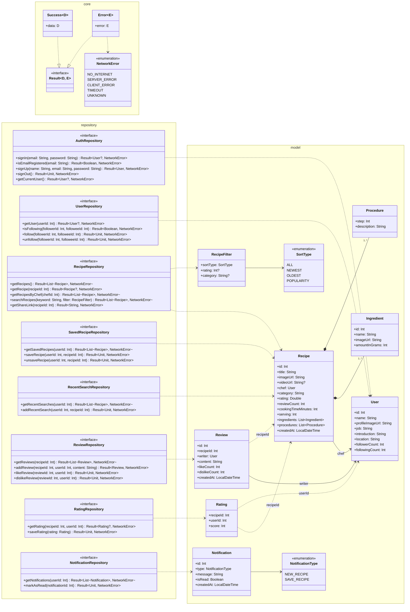

# 설계 원칙, 디자인 패턴

## 용어 정리

- `응집도 (Cohesion)`: 모듈이 하나의 목적을 수행하는 요소들간의 연관성 척도. 모듈 내부의 기능적인 응집 정도를 나타냄
- `결합도 (Coupling)`: 모듈이 다른 모듈에 의존하는 정도의 척도. 모듈과 모듈 간의 상호 결합 정도를 나타냄

## 클래스 다이어그램 코드



## 정리

- `응집도는 높게, 결합도는 낮게`
  - `높은 응집도`: 모듈이 하나의 특정 작업이나 기능에 집중
    - e.g. `UserAuthentication 클래스`: 로그인, 로그아웃, 비밀번호 변경 기능
  - `낮은 응집도`: 모듈이 여러 가지 서로 관련 없는 작업을 수행
    - e.g. `Util 클래스`: 문자열 처리, 파일 읽기, 날짜 계산 기능
  - `낮은 결합도`: 모듈이 서로 독립적으로 작동할 수 있을 때
    - e.g. `UserAuthentication 클래스` 가 특정 클래스가 아니라 인터페이스를 통해 사용자 정보를 가져오는 경우
  - `높은 결합도`: 모듈이 서로 강하게 연결되어 있을 때
    - e.g. `UserAuthentication 클래스` 가 특정 클래스의 내부 구현에 직접 의존하는 경우

- `좋은 코드를 위해 의식해야 하는 6가지 코드 작성 원칙`
  - `DRY (Don't Repeat Yourself)`
    - 같은 것을 몇번씩 반복하지 않는다.
    - 중복 코드가 있다면 메서드로 분리한다.
  - `PIE (Program Intently and Expressively)`
    - 애매한 이름을 쓰지 않는다.
    - 누가 봐도 알기 쉬운 이름을 사용한다.
    - 컨벤션을 따른다.
    - 매직 넘버에 이름을 붙인다.
  - `SRP (Single Responsibility Principle)`
    - 단일 책임 원칙
    - 1개의 클래스는 1개의 일만 한다.
    - 외부 객체는 생성자로 주입 받는다.
    - 클래스는 하나의 기능이나 책임만을 가져야 하며, 그 책임이 변경될 때 해당 클래스만 수정한다.
    - 적절한 수준의 클래스 분리를 유지하는 것이 중요하다.
  - `OCP (Open Closed Principle)`
    - 개방 폐쇄 원칙
    - 확장에 대해서는 열려있고 (확장은 자유롭고), 변경에 대해서는 닫혀있다 (의존 부분의 변경은 불필요)
    - 수정 없이 확장 가능하도록 한다.
    - 원본 코드를 수정없이 새로운 기능을 추가할 수 있다.
    - `Iterable`, `Comparator` 등이 좋은 예시이다.
    - `String` 의 경우는 상속 금지이므로 `OCP` 에 반하는 클래스의 대표적인 예시이다.
    - 인터페이스를 적극 활용하여 확장 가능하게 한다.
  - `SDP (Stable Dependencies Principle)`
    - 안전한 것에 의존한다.
    - ATM 시스템을 예로 들면, 암호 처리 같이 한번 완성되면 수정될 가능성이 없는 클래스에 의존할 만 하다.
    - 하지만 가장 좋은 것은 특정 클래스가 아니라 인터페이스에 의존하는 것이다.
    - 클래스는 생성자가 변하거나 할 수 있으나 인터페이스는 거의 그대로이기 때문
  - `ADP (Acyclic Dependencies Principle)`
    - 의존성 비순환 원칙
    - 의존 관계에 사이클이 발생되지 않게 한다.

- `SOLID 원칙`
  - `SRP`
    - `단일 책임 원칙 (Single Responsibility Principle)`
    - 한 클래스는 하나의 책임만 가져야 한다.
  - `OCP`
    - `개방 폐쇄 원칙 (Open/Closed Principle)`
    - 소프트웨어 요소는 확장에는 열려 있으나 변경에는 닫혀 있어야 한다.
  - `LSP`
    - `리스코프 치환 원칙 (Liskov Substitution Principle)`
    - 프로그램의 객체는 프로그램의 정확성을 깨뜨리지 않으면서 하위 타입의 인스턴스로 바꿀 수 있어야 한다.
    - 계약에 의한 설계를 참고한다.
    - `is-a` 원칙을 지킨다.
  - `ISP`
    - `인터페이스 분리 원칙 (Interface Segragation Principle)`
    - 특정 클라이언트를 위한 인터페이스 여러 개가 범용 인터페이스 하나보다 낫다.
  - `DIP`
    - `의존 관계 역전 원칙 (Dependency Inversion Principle)`
    - 추상화에 의존하고, 구체화에 의존하면 안된다.
    - 의존성 주입은 이 원칙을 따르는 방법 중 하나이다.

- `디자인 패턴`
  - `소프트웨어 디자인 패턴` 은 소프트웨어 공학의 소프트웨어 디자인에서 특정 문맥에서 공통적으로 발생하는 문제에 대해 재사용 가능한 해결책이다.
  - `디자인 패턴` 은 프로그래머가 어플리케이션이나 시스템을 디자인할 때 공통된 문제들을 해결하는데에 쓰이는 형식화 된 좋은 관행이다.

- `디자인 패턴을 공부했을 때의 장점`
  - 개발자간에 커뮤니케이션이 원만해 진다.
  - 객체지향 설계 원칙의 이해도가 좋아진다.
  - 거대 객체 방지
    - 상태 패턴 적용하여 `SRP` `OCP` 원칙을 지킬 수 있다.
    - 수많은 `if-else` 방지
  - 잦은 기획 변경, 신규 콘텐츠 확장에 대응
    - 새로운 스킬 추가, 보스 패턴 변경 대응 등
    - `팩토리` `전략` 패턴을 사용할 수 있다.
  - 시스템 간 결합도 최소화
    - 플레이어 사망 시 UI 갱신, 사망 사운드 재생, 업적 달성 등
    - `옵저버` `이벤트 드리븐` 패턴을 사용할 수 있다.

- `GoF의 23가지 디자인 패턴`
  - `Gang Of Four` 라는 4명의 개발자가 정리한 디자인 패턴
  - `디자인 패턴` 이라고 부르는 것은 대부분 여기서 나온다.
  - 패턴은 아래와 같이 정리할 수 있다.
    - `생성(Creational) 패턴`
      - 추상 팩토리(Abstract Factory)
      - `빌더(Builder)`
      - `팩토리 메서드(Factory Methods)`
      - 프로토 타입(Prototype)
      - `싱글턴(Singleton)`
    - `구조(Structural) 패턴`
      - 어댑터(Adapter)
      - 브리지(Bridge)
      - 컴퍼지트(Composite)
      - `데커레이터(Decorator)`
      - `퍼사드(Facade)`
      - 플라이웨이트(Flyweight)
      - 프록시(Proxy)
    - `행위(Behavioral) 패턴`
      - 책임 연쇄(Chain of Responsibility)
      - 커맨드(Command)
      - 인터프리터(Interpreter)
      - `이터레이터(Iterator)`
      - 미디에이터(Mediator)
      - 메멘토(Memento)
      - `옵서버(Observer)`
      - 스테이트(State)
      - 스트래티지(Strategy)
      - 템플릿 메서드(Template Method)
      - 비지터(Visitor)

- `빌더(Builder) 패턴`
  - 복잡한 객체를 단계적으로 생성하는 데 유용하다.

```kotlin
// StringBuilder 객체를 생성하고, append를 체이닝하여 데이터 추가
val sentence = StringBuilder()
  .append("Name: ")
  .append(name)
  .append(", Age: ")
  .append(age)
  .append(" from ")
  .append(city)
  .toString() // 최종적으로 String으로 변환
```

- `팩토리 메서드(Factory Method) 패턴`
  - 인스턴스를 만드는 패턴

- `싱글턴(Singleton) 패턴`
  - 1개의 인스턴스만 생성되는 것을 보증하기 위한 패턴
  - 인스턴스 생성을 여러번 시도해도 1개의 인스턴스가 공유된다.
  - 캐시나 공유 데이터, 처리의 효율화 등에서 사용된다.

```kotlin
object RentCar {
  var count = 0
}

fun main() {
  val car1 = RentCar
  car1.count++
  val car2 = RentCar

  println(car2.count)
}
```

- `데커레이터(Decorator) 패턴`

```kotlin
Scaffold(
  topBar = {
    TopAppBar(title = { Text("App bar") })
  },
  floatingActionButton = {
    FloatingActionButton(onClick = { /* Do something */ }) {
      Text("Button")
    }
  }
) { paddingValues -> ... }
```

- `이터레이터(Iterator) 패턴`
  - 반복 구조
  - e.g. `ResultSet.next()` 메서드 커서의 이동

- `퍼사드(Facade) 패턴`
  - 복잡한 하위 시스템을 단순화 하기 위한 패턴
  - 내부를 감추고 심플하게 한다.
  - `데이터 접근 계층`: DataSource 처리를 몰라도 된다. (Repository)
  - `라이브러리 사용`: 복잡한 네트워크 통신을 모랄도 된다. (HttpClient)

- `전략(Strategy) 패턴`
  - 런타임에 알고리즘을 동적으로 교체할 수 있도록 한다.
  - 알고리즘 교체 용이성
  - `OCP` 준수
  - 조건문 제거

- `옵저버(Observer) 패턴`
  - 객체의 상태 변화를 관찰하는 `관찰자들(옵저버)` 들의 목록을 객체에 등록하여 상태 변화가 있을 때마다 메서드 등을 통해 객체가 직접 목록의 각 `옵저버` 에게 통지하도록 하는 `디자인 패턴`
  - 주로 `분산 이벤트 핸들링 시스템` 을 구현하는 데 사용된다.
  - `발행/구독 모델` 로도 알려져 있다.
  - `콜백 함수` 는 `옵저버 패턴` 의 구현 방식 중 하나이다.

```kotlin
class Button(
  private val onPressed: () -> Unit
) {
  fun click() = onPressed.invoke()
}

val button = Button(onPressed = {
  println("클릭")
})

button.click()
```

- `아키텍처 디자인 패턴`
  - 소프트웨어를 작성함에 있어 코드 뿐만 아니라 전체적인 구조(Architecture)에 대한 좋은 패턴도 존재한다.
  - 가장 대중적인 패턴들은 다음과 같다.
    - `MVC`
    - `MVC2`
    - `MVP`
    - `MVVM`
    - `MVI`

- `MVVM 기반의 클린 아키텍처 구조`
  - `UI Layer`: 플랫폼 영역
  - `Domain Layer (optional)`: 순수 언어 영역
  - `Data Layer (Repositories, Data Sources)`: 언어 및 플랫폼 영역

- `비즈니스 규칙 (데이터를 판단하고 가공하는 함수)`
  - 화면(UI) -> 비즈니스 규칙 함수(메서드) -> Repository -> DataSource
  - 화면(UI)과 데이터(Repository) 사이에서 순수 코틀린으로 비즈니스 규칙을 판단하고 가공하는 함수(메서드)
  - 비즈니스 규칙 판정
  - 여러 Repository 조합
  - 입력값 검증 및 데이터 가공

- `화면(UI)이 점점 비대해 지는 문제`
  - 화면에서 Repository를 직접 호출할 때 생기는 문제
  - `화면(UI)의 비대화`
    - 입력 검증, 다중 Repository 호출, 비즈니스 판정, 에러 분기를 화면(UI)이 모조리 떠맡아 코드가 비대해진다.
  - `비즈니스 로직과 화면의 결합`
    - 화면 코드와 비즈니스 규칙이 뒤섞여, 비즈니스 로직만 따로 떼어내 단위 테스트(Unit Test) 작성이 어려워진다.

- `비즈니스 로직(규칙) 함수의 역할`
  - 화면(UI)을 모르는 채로, 순수한 업무 정책(규칙)을 적용하고 결과를 돌려주는 함수
    - `입력 검증`: 빈 이름 거르기, 검색어 최소 길이 검증
    - `규칙 적용`: 북마크 최대 개수 제한, 권한/등급 체크
    - `여러 Repository 조합`: 데이터 및 북마크 여부 합성
  - 데이터 입출력(Repository)과 구분되는 판단과 정책(규칙)의 책임

- `에러의 종류 (데이터 실패 및 규칙 실패)`
  - Not Found, NetworkError 등 `데이터 실패` 는 Repository가 뱉는다.
  - EmptyQuery, LimitExceeded 등 `규칙 실패` 는 비즈니스 규칙 함수가 뱉는다.

- `함수 분리 기준 (단순 조회 및 비즈니스 규칙 함수)`
  - 모든 곳에 규칙 판정 함수가 필요하지는 않는다.
  - `단순 조회 (규칙 없음)`
    - 단순 CRUD, 비즈니스 판정은 없다. (e.g. ID로 단건 상세 조회)
    - 화면(UI)에서 Repository 메서드를 직접 호출해도 충분하다.
  - `비즈니스 규칙 함수 필요`
    - 입력값 검증이 필요할 때 (e.g. 검색어 2글자 이상 검증)
    - 2개 이상의 Repository를 조합할 때 (e.g. 데이터 목록 및 북마크 여부 합성)
    - 정책적 제한 및 판단이 있을 때 (e.g. 북마크 100개 제한)
