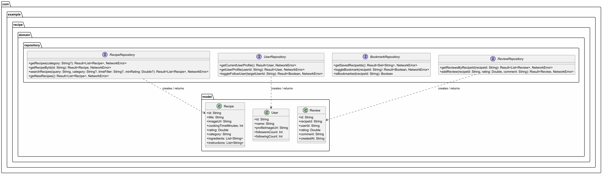

2026-11-06
# Day 21 - Kotlin(설계원칙, 디자인 패턴)

- **작성자**: 박강원
- **작성일**: 2026-11-06

- 주제 내용
### 1.  좋은 설계원칙이란?
- 응집도와 결합도:
    - 응집도 (높아야 좋음!): 
      레고 상자 안에 '자동차 부품만' 모아둔 것처럼, 한 클래스가 자기 맡은 일 하나에만 똘똘 뭉쳐서 집중하는 정도예요.   
    - 결합도 (낮아야 좋음!): 
      친구끼리 실전화기로 강하게 연결되어 있으면 이동하기 힘든 것처럼, 클래스끼리 너무 세세하게 연결되어 있으면 수정하기 힘들어져요. 
      독립적으로 일할 수 있게 연결을 느슨하게 풀어주어야 합니다.   
- 6가지 핵심 설계 원칙:DRY: 똑같은 일을 몇 번이고 반복하지 말기 (중복 코드 금지!)   
     - PIE: 이름짓기를 명확하게 해서 누구나 읽기 쉽게 작성하기   
     - SRP (단일 책임 원칙): 마법사 클래스가 주방장 일까지 하지 않기 (한 클래스는 단 하나의 역할만!)   
     - OCP (개방 폐쇄 원칙): 게임 캐릭터에 새 스킬을 추가할 때 기존 공격 코드를 안 고치고도 확장 가능하게 만들기   
     - SDP (안정된 의존성 원칙): 쉽게 바뀌는 것에 의존하지 말고, 변하지 않는 약속(인터페이스)에 의존하기   
     - ADP (의존성 비순환 원칙): A가 B를 부르고 B가 A를 다시 부르는 '돌고 도는 굴레(순환 참조)'를 만들지 말기   
     - SOLID 원칙과 GoF 디자인 패턴: 선배 개발자들이 공통적으로 만나는 문제들을 해결하기 위해 만든 최고의 레시피(규칙 모음)입니다.   
         예: 빌더(Builder) = 서브웨이 샌드위치 재료를 단계별로 골라 완성하기
         예: 싱글톤(Singleton) = 세상에 딱 하나만 존재하는 공유 자동차 렌트하기   
         예: 전략(Strategy) = 쉬움/어려움 난이도 AI 알고리즘을 런타임에 쓱 갈아 끼우기   
         클린 아키텍처와 비즈니스 규칙:화면(UI)이 너무 뚱뚱해지지 않도록 "입력값 검증"이나 "미네랄이 50개 이상 있는지 판단하는 업무 정책"은 
         비즈니스 규칙 함수가 전담하고, 데이터 가져오기는 Repository가 전담하도록 깔끔하게 나눕니다.

### 2. 핵심 명령어 및 주요 개념정리
- 구분               개념 및 설명주요                            내용
- SRP                단일책임 원칙            하나의 클래스는 딱 하나의 변경 이유(책임)만 가짐.   
- OCP               개방-폐쇄 원칙            기능 확장에는 열려 있으나(Open), 기존 코드 수정에는 닫혀 있음(Closed).   
- DIP               의존관계 역전 원칙         구체적인 클래스 대신 추상화된 인터페이스에 의존함.   
- Singleton         object 키워드            메모리에 단 하나의 인스턴스만 생성하여 공유.   
- Builder           StringBuilder()         복잡한 객체를 단계적으로 체이닝하여 안전하게 생성.   
- Strategy          전략 패턴                동일 인터페이스를 통해 실행 중에 알고리즘을 동적으로 교체.   
- Observer          관찰자 패턴/콜백          상태 변화가 일어날 때 등록된 수신자(콜백 함수)에게 알림 통지.

### 3. 디자인 패턴
-  소프트웨어 디자인 패턴(software design pattern)은 소프트웨어 공학의 소프트웨어 디자인에서 특정 문맥에서 
   공통적으로 발생하는 문제에 대해 재사용 가능한 해결책이다.
   디자인 패턴은 프로그래머가 어플리케이션이나 시스템을 디자인할 때 공통된 문제들을 해결하는데에 쓰이는 형식화 된 
   가장 좋은 관행이다.
   결론 : 설계 원칙과 노하우를 정리한 것. 선배님들이 정리한 것을 공부하자.

-  개발자간에 커뮤니케이션이 원만해 진다
-  객체지향 설계 원칙의 이해도가 좋아진다
-  거대 객체 방지 : 상태 패턴 적용하여 SRP, OCP 를 지킬 수 있음
   -  수많은 if-else 방지
-  잦은 기획 변경, 신규 콘텐츠 확장에 대응 : 팩토리, 전략 패턴
   -  새로운 스킬 추가, 보스 패턴 변경 대응
-  시스템 간 결합도 최소화 : 옵저버, 이벤트 드리븐 패턴
   -  플레이어 사망시 UI 갱신, 사망 사운드 재생, 업적 달성
   
-  Gang Of Four 라는 4명의 개발자가 정리한 디자인 패턴

#### 과제 1.
제공해주신 레시피 앱 피그마 디자인 분석을 바탕으로, UI에 표시되는 정보들을 분석하여 도출한 
**도메인 객체(모델 클래스) 및 속성 정의**입니다.

### 1. Recipe (레시피)

레시피 탐색, 상세 화면, 검색 결과, 북마크 등 앱 전체에서 가장 핵심적으로 사용되는 데이터 모델입니다.

* **`id`**: `String` - 레시피 고유 식별자
* **`title`**: `String` - 레시피 이름 (예: "Spicy chicken burger with French Fries")
* **`imageUrl`**: `String` - 레시피 대표 이미지 URL
* **`cookingTimeMinutes`**: `Int` - 조리 소요 시간 (분 단위, 예: 20 mins)
* **`rating`**: `Double` - 평점 (예: 4.8)
* **`category`**: `String` - 카테고리 분류 (예: Salad, Chief, Breakfast 등)
* **`chef`**: `Chef` - 레시피를 등록한 요리사/작성자 정보
* **`ingredients`**: `List<Ingredient>` - 필요한 재료 목록 (재료 이름, 용량 등)
* **`instructions`**: `List<String>` - 조리 순서/단계별 설명
* **`isBookmarked`**: `Boolean` - 사용자가 북마크(저장)했는지 여부

### 2. Chef (요리사 / 작성자)

레시피 카드나 상세 화면에서 작성자의 이름과 프로필을 나타내는 하위 모델 또는 독립 모델입니다.

* **`id`**: `String` - 셰프 고유 식별자
* **`name`**: `String` - 셰프 이름 (예: "James Milner")
* **`profileImageUrl`**: `String` - 셰프 프로필 이미지 URL
* **`location`**: `String` - 활동 지역 또는 소속 (예: "Lagos, Nigeria")

### 3. Ingredient (재료)

레시피 상세 화면에서 필요한 재료와 용량을 표시하기 위한 모델입니다.

* **`id`**: `String` - 재료 고유 식별자
* **`name`**: `String` - 재료 이름 (예: "Tomato", "Chicken", "Garlic")
* **`imageUrl`**: `String` - 재료 아이콘/이미지 URL
* **`amount`**: `String` - 필요 용량 (예: "500g", "1tbsp")

### 4. Review (리뷰 및 평점)

레시피 상세 화면 하단 및 리뷰 작성 팝업에서 사용자가 남긴 별점과 후기를 나타내는 모델입니다.

* **`id`**: `String` - 리뷰 고유 식별자
* **`recipeId`**: `String` - 대상 레시피 ID
* **`userId`**: `String` - 작성자 ID
* **`userName`**: `String` - 작성자 이름
* **`userProfileImageUrl`**: `String` - 작성자 프로필 이미지 URL
* **`rating`**: `Double` - 부여한 별점 (1.0 ~ 5.0)
* **`comment`**: `String` - 리뷰 내용 텍스트
* **`createdAt`**: `String` - 작성 일시

### 5. User (사용자 / 프로필)

마이페이지(Profile) 화면 및 알림, 설정 화면에서 사용되는 사용자 정보 모델입니다.

* **`id`**: `String` - 사용자 고유 식별자
* **`name`**: `String` - 사용자 이름
* **`email`**: `String` - 이메일 주소
* **`profileImageUrl`**: `String` - 프로필 사진 URL
* **`recipeCount`**: `Int` - 내가 올린 레시피 수
* **`followingCount`**: `Int` - 팔로잉 수
* **`followersCount`**: `Int` - 팔로워 수

### 문제 2.
레시피 앱 피그마 디자인 분석을 바탕으로 도출된 도메인 객체들에 대한 Repository 인터페이스 설계 내용입니다.
Repository 계층은 데이터 소스(Local DB, Remote API 등)의 구체적인 구현 방식을 숨기고, 비즈니스 로직 영역에 
순수한 도메인 객체 단위의 표준화된 데이터 인터페이스를 제공하는 책임을 가집니다.

1. RecipeRepository (레시피 데이터 관리)
   책임과 역할:
   레시피 검색, 카테고리별 목록 조회, 상세 정보 및 메인 화면용 추천/신규 레시피 데이터를 원격 서버나 로컬 저장소로부터 
   가져오는 작업을 담당합니다.
   UI나 비즈니스 규칙 계층이 데이터베이스나 네트워크 통신 기술에 직접 의존하지 않도록 분리합니다.
   핵심 메서드:

Kotlin
interface RecipeRepository {
// 카테고리별 레시피 목록 조회
suspend fun getRecipes(category: String? = null): Result<List<Recipe>, NetworkError>

    // 레시피 ID 기반 단건 상세 조회
    suspend fun getRecipeById(id: String): Result<Recipe, NetworkError>

    // 검색어 및 필터 조건에 따른 레시피 검색
    suspend fun searchRecipes(query: String, category: String? = null): Result<List<Recipe>, NetworkError>

    // 메인 화면용 신규/추천 레시피 조회
    suspend fun getNewRecipes(): Result<List<Recipe>, NetworkError>
}
2. BookmarkRepository (북마크/저장된 레시피 관리)
   책임과 역할:
   사용자가 마음에 드는 레시피를 저장(북마크)하거나 해제하는 상태 변경 및 저장된 레시피 ID 목록을 관리합니다.
   로컬 DB(Room 등)와의 연동을 주로 담당하며, 북마크 상태 동기화를 캡슐화합니다.
   핵심 메서드:

Kotlin
interface BookmarkRepository {
// 사용자가 저장한 북마크 레시피 ID 목록 조회
suspend fun getSavedRecipeIds(): Result<Set<String>, NetworkError>

    // 특정 레시피 북마크 상태 토글 (추가/제거 후 최종 상태 반환)
    suspend fun toggleBookmark(recipeId: String): Result<Boolean, NetworkError>

    // 특정 레시피의 북마크 여부 확인 (동기식 또는 단건 확인)
    suspend fun isBookmarked(recipeId: String): Boolean
}
3. UserRepository (사용자 프로필 및 계정 관리)
   책임과 역할:

   현재 로그인한 사용자의 프로필 정보, 다른 셰프의 프로필 조회 및 셰프 팔로우/언팔로우 관계를 관리합니다.
   핵심 메서드:

Kotlin
interface UserRepository {
// 현재 로그인한 사용자 프로필 조회
suspend fun getCurrentUserProfile(): Result<User, NetworkError>

    // 특정 셰프/사용자 프로필 조회
    suspend fun getUserProfile(userId: String): Result<User, NetworkError>

    // 셰프 팔로우 상태 토글
    suspend fun toggleFollowUser(targetUserId: String): Result<Boolean, NetworkError>
}
4. ReviewRepository (리뷰 및 평점 관리)
   책임과 역할:

   특정 레시피에 달린 사용자들의 리뷰 목록을 조회하고, 새로운 리뷰와 평점을 등록하는 데이터 처리를 담당합니다.
   핵심 메서드:
Kotlin
interface ReviewRepository {
// 특정 레시피의 리뷰 목록 조회
suspend fun getReviewsByRecipeId(recipeId: String): Result<List<Review>, NetworkError>

    // 레시피 리뷰 및 평점 등록
    suspend fun addReview(recipeId: String, rating: Double, comment: String): Result<Review, NetworkError>
}

### 문제 3.
피그마 디자인(Food Recipe App) 분석을 기반으로 도출한 핵심 비즈니스 규칙 및 블랙박스 스펙 정의입니다. 
(코드 작성 없이 기능 스펙으로만 정리했습니다.)

1. 단순 조회라 Repository 직통으로 충분한 기능 (1~2개)
   별도의 복잡한 입력값 검증이나 정책적 제한 없이, 데이터 소스에서 가져온 데이터를 그대로 UI에 전달하는 단순 조회 기능입니다.

   레시피 단건 상세 조회 (Recipe Detail)
   사용자가 레시피 카드를 클릭했을 때 해당 레시피의 상세 정보(재료, 조리 순서 등)를 그대로 불러오는 기능.
   카테고리별 레시피 목록 조회
   선택한 카테고리(예: Salad, Breakfast 등)에 해당하는 레시피 리스트를 필터링 없이 그대로 가져오는 기능.

2. 비즈니스 규칙(판정/가공) 함수가 필요한 기능 (2~3개)
   단순 조회를 넘어 입력값 검증, 정책적 제한(개수 제한 등), 또는 2개 이상의 Repository를 조합해야 하는 비즈니스 로직이 포함된 기능입니다.

   검색어 유효성 검증 및 레시피 검색
   검색어의 공백 여부나 최소 글자 수 조건을 검증한 후 레시피를 검색하는 기능.
   레시피 북마크 추가 (최대 개수 제한 정책)
   사용자가 레시피를 저장할 때 현재 북마크 개수가 허용된 최대 개수를 초과했는지 검사하고 차단하는 기능.
   레시피 목록과 북마크 여부 데이터 합성
   원격 레시피 데이터와 로컬 북마크 ID 목록을 동시에 조합하여 각 레시피의 하트(북마크) 상태를 완성하는 기능.

3. 각 기능의 블랙박스 스펙 정의
   [기능 1] 검색어 유효성 검증 및 레시피 검색
   필요한 부품 (Repositories): RecipeRepository
   입력값 (Parameters): query: String (사용자가 입력한 검색어)
   결과물 (Result):
   성공 데이터: List<Recipe> (검색된 레시피 목록)
   실패 규칙 에러 (Enum): SearchRuleError
   EMPTY_QUERY (검색어가 비어 있음)
   QUERY_TOO_SHORT (검색어가 최소 글자 수 미만임)

   [기능 2] 레시피 북마크 추가 (최대 개수 제한 정책)
   필요한 부품 (Repositories): RecipeRepository, BookmarkRepository
   입력값 (Parameters): recipeId: String (추가할 레시피 ID)
   결과물 (Result):
   성공 데이터: Boolean (북마크 추가 성공 여부)
   실패 규칙 에러 (Enum): BookmarkRuleError
   LIMIT_EXCEEDED (북마크 최대 저장 개수 100개 초과)
   ALREADY_EXISTS (이미 북마크된 레시피)

   [기능 3] 레시피 목록과 북마크 여부 합성
   필요한 부품 (Repositories): RecipeRepository, BookmarkRepository
   입력값 (Parameters): category: String? (선택된 카테고리 필터)
   결과물 (Result):
   성공 데이터: List<RecipeUiModel> (북마크 여부 isBookmarked가 반영된 레시피 목록)
   실패 규칙 에러 (Enum): RecipeCombineRuleError
   SYNC_FAILED (원격 레시피와 로컬 북마크 데이터 간 합성 오류 발생)

다이어그램 구조 설명
-   Domain Model 패키지: 앱에서 사용하는 핵심 데이터 구조인 Recipe(레시피), User(사용자), Review(리뷰) 클래스를 정의했습니다.
-   Repository Interface 패키지: 각 도메인 영역별 데이터 연동 규칙을 정의한 RecipeRepository, BookmarkRepository, 
    UserRepository, ReviewRepository 인터페이스를 설계하여 구체적인 데이터 소스로부터 비즈니스 로직을 분리(DIP 원칙 준수)했습니다.

### 레시피 앱 비즈니스 규칙 및 아키텍처 스펙 문서 (business_rules.md)

1. 단순 조회 기능 (UI → Repository 직통)
비즈니스 가공이나 판정 정책 없이 데이터 소스의 조회를 직접 전달하는 기능입니다.

1.1 레시피 단건 상세 정보 조회 (getRecipeDetail)
목적: 사용자가 특정 레시피를 선택했을 때 해당 레시피의 세부 정보(재료, 조리 순서, 평점 등)를 조회합니다.
이유: 단순 단건 CRUD 읽기 작업으로, 추가적인 검증이나 데이터 가공 규칙이 불필요합니다.
호출 구조: UI Layer ➡️ RecipeRepository.getRecipeById(id)

2. 비즈니스 규칙(판정/가공) 기능 스펙
검증, 정책 제한, 다중 데이터 조합 등 도메인 판정 로직이 포함된 기능들의 블랙박스 스펙입니다.

[기능 1] 검색어 유효성 검증 및 레시피 검색 (SearchRecipesUseCase)
1. 목적
사용자가 입력한 검색어의 유효성(공백, 최소 글자 수)을 검증한 뒤, 규칙에 부합할 경우에만 검색을 수행하여 불필요한 네트워크/DB 요청을 방지합니다.
2. 비즈니스 규칙 (Policy & Validation)
검색어(query)가 비어 있거나 공백으로만 구성된 경우 검색을 진행하지 않고 SearchRuleError.EMPTY_QUERY를 반환합니다.
검색어가 2글자 미만인 경우 검색을 진행하지 않고 SearchRuleError.QUERY_TOO_SHORT를 반환합니다.
위의 검증 조건을 통과한 경우에만 RecipeRepository.searchRecipes를 호출합니다.
3. 필요한 부품 (Repositories)
RecipeRepository
4. 입력값 (Parameters)
query: String (사용자 입력 검색어)
category: String? (선택적 카테고리 필터)
5. 결과물 (Result Specification)
성공 (Success): Result.Success<List<Recipe>>
규칙 실패 에러 (Enum): SearchRuleError
enum class SearchRuleError {
EMPTY_QUERY,       // 검색어가 비어 있음
QUERY_TOO_SHORT    // 검색어가 2글자 미만임
}

[기능 2] 북마크 추가 정책 검증 및 토글 (AddBookmarkWithLimitUseCase)
1. 목적
사용자가 북마크를 추가할 때 보유 가능한 최대 북마크 개수 제한을 체크하고 정책 초과 시 추가를 차단합니다.
2. 비즈니스 규칙 (Policy & Validation)
BookmarkRepository.getSavedRecipeIds()를 통해 현재 사용자가 저장한 북마크 개수를 확인합니다.
이미 북마크에 존재하는 레시피인 경우 해제(삭제) 로직을 수행합니다.
신규 추가 건에 대해 현재 북마크 저장 개수가 100개 이상인 경우 작업을 거부하고 BookmarkRuleError.LIMIT_EXCEEDED를 반환합니다.
제한 이내인 경우 북마크를 추가하고 저장 상태를 리턴합니다.
3. 필요한 부품 (Repositories)
BookmarkRepository
4. 입력값 (Parameters)
recipeId: String (대상 레시피 ID)
5. 결과물 (Result Specification)
성공 (Success): Result.Success<Boolean> (최종 북마크 등록 여부 - true: 등록됨, false: 해제됨)
규칙 실패 에러 (Enum): BookmarkRuleError
enum class BookmarkRuleError {
LIMIT_EXCEEDED    // 최대 북마크 개수(100개) 초과
}

[기능 3] 북마크 여부가 포함된 레시피 목록 합성 (GetRecipesWithBookmarkStatusUseCase)
1. 목적
서버/데이터베이스의 레시피 리스트 데이터와 사용자의 북마크 목록 데이터를 조합하여 UI 표시용 하트(북마크 여부) 상태가 반영된 데이터를 생성합니다.
2. 비즈니스 규칙 (Data Combination)
RecipeRepository.getRecipes(category)를 통해 해당 카테고리의 레시피 리스트를 가져옵니다.
BookmarkRepository.getSavedRecipeIds()를 통해 사용자가 저장한 북마크 ID Set을 가져옵니다.
두 데이터를 합성하여 각 레시피마다 isBookmarked = savedRecipeIds.contains(recipe.id) 값을 매핑한 RecipeUiModel 목록을 생성합니다.
3. 필요한 부품 (Repositories)
RecipeRepository
BookmarkRepository
4. 입력값 (Parameters)
category: String? (조회할 레시피 카테고리)
5. 결과물 (Result Specification)
성공 (Success): Result.Success<List<RecipeUiModel>>
RecipeUiModel: Recipe 데이터 + isBookmarked: Boolean
규칙 실패 에러 (Enum): CombineRuleError
enum class CombineRuleError {
DATA_MISMATCH    // 레시피 데이터와 북마크 정보 간 정합성 오류 발생
}

###  AI 질문 및 학습인사이트(공통)
- Design 페이지를 분석하여 레시피 앱 Figma를 분석하여 다음을 도출 
     1. 단순 조회라 Repository 직통으로 충분한 기능 1~2개
     2. 비즈니스 규칙(판정/가공) 함수가 필요한 기능 2~3개
     3. 각 기능의 블랙박스 스펙 정의:
        • 필요한 부품: 어떤 Repository(들)가 필요한가?
        • 입력값: 실행에 필요한 매개변수는 무엇인가?
        • 결과물 (Result): 성공 데이터 & 실패 규칙 에러(Enum)

-  architecture.puml (PlantUML 클래스 다이어그램) 모델 클래스 정의 및 Repository 인터페이스 정의  
-  business_rules.md (Markdown 스펙 문서)핵심 기능별 목적, 비즈니스 규칙, 필요한 부품(Repo)
입력값 및 결과물 (Result 성공 데이터, 규칙 에러 Enum)
- ※ 비즈니스 규칙은 다이어그램에 그리지 않고 Markdown 문서로만 작성

#### 회고.
- 단순한 코드 구현을 넘어 "어떻게 하면 유지보수가 쉽고, 확장 가능하며, 견고한 소프트웨어를 설계할 것인가?"에 
  대한 깊이 있는 통찰을 얻는 소중한 시간이었습니다.

- ** "열심히 끝까지 달려보겠습니다."**