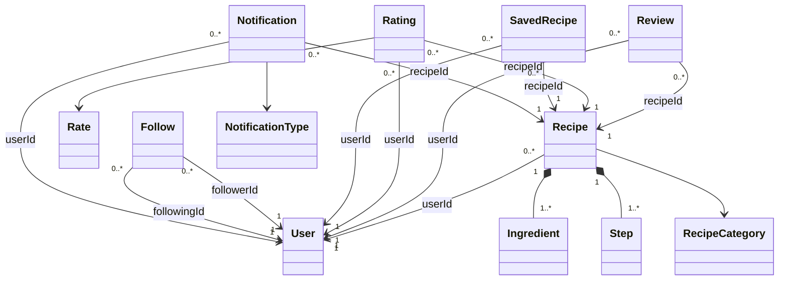

# 레시피 앱 도메인 / Repository / 기능 스펙 설계

> 분석 대상: [Food Recipe App (Community) – Design 페이지](https://www.figma.com/design/gSeg6yi2QMN0GajM3diTb2/Food-Recipe-App--Community-?node-id=1-3&p=f)
>
> 코드 작성 없이 **UI → 도메인 → Repository → 기능 블랙박스 스펙** 순서로 도출한다.

---

## 0. 화면 목록과 화면에 보이는 정보

| 화면 | UI에 표시되는 정보 / 동작 |
|---|---|
| Splash | 앱 소개 문구, `Start Cooking` |
| Sign In | Email, Password, Forgot Password, Google/Facebook 로그인, Sign up 이동 |
| Sign Up | Name, Email, Password, Confirm Password, Accept terms & Condition 체크 |
| Home | `Hello Jega`(사용자 이름), 프로필 이미지, 검색창, 카테고리 탭(All / Indian / Italian / Asian / Chinese), 레시피 카드(이미지, 평점 4.5, 제목, 조리시간 15 Mins, 북마크), **New Recipes**(제목, 별점, 작성자 이름·사진, 조리시간 20 mins) |
| Search | 검색창, 필터 버튼, **Recent Search** 레시피 카드(제목, 작성자, 평점) |
| Search Result | 검색 키워드(`Jollof rice`), `255 results`(결과 수), 결과 레시피 카드 |
| Filter | Time(All / Newest / Oldest / Popularity), Rate(5~1★), Category(All, Cereal, Vegetables, Dinner, Chinese, Local Dish, Fruit, Breakfast, Spanish, Lunch), `Filter` 버튼 |
| Saved Recipe | 저장한 레시피 카드(이미지, 제목, 작성자, 평점, 조리시간 20 min) |
| Recipe / Ingredient | 레시피 이미지, 평점, 조리시간, 제목, `(13k Reviews)`, 작성자(이름, 사진, 위치 `Lagos, Nigeria`), `Follow`, 탭(Ingredient / Procedure), `1 serve`, `10 Items`, 재료 리스트(이미지, 이름, 양 500g) |
| Recipe / Procedure | 영상 재생 버튼, `1 serve`, `10 Steps`, Step 1~N 설명 |
| Recipe / More (`⋯`) | share, Rate Recipe, Review, Unsave |
| Rate Recipe (팝업) | 별 5개 선택, 별 0개일 때 `Send` 비활성 → 1개 이상 선택 시 활성 |
| Share (팝업) | Recipe Link(`app.Recipe.co/jollof_rice`), `Copy Link` → `Link Copied` 토스트 |
| Reviews | `200 Comments`, `155 Saved`, 댓글 입력창 + `Send`, 댓글 리스트(작성자 사진·이름, 작성 일시, 내용, 👍/👎 반응 수) |
| Notifications | 탭(All / Read / Unread), Today / Yesterday 그룹, 알림 카드(`New Recipe Alert!` / `Save Recipe Alert!`, 내용, `10 mins ago`, 읽음/안읽음 표시) |
| Profile | 프로필 사진, 이름, 직업(`Chef`), 소개글, Recipe 4 / Followers 2.5M / Following 259, 탭(Recipe / Videos / Tag), 작성 레시피 카드 |

---

## 1. 도메인 객체 도출

| 도메인 객체 | 도출 근거 (화면) | 설명 |
|---|---|---|
| `User` | Home 인사말, Profile, 레시피 작성자, 리뷰 작성자 | 앱 사용자이자 레시피 작성자(Chef) |
| `Recipe` | Home, Search, Saved, Recipe 상세, Profile | 앱의 핵심 엔티티. 재료와 조리 단계를 포함하는 Aggregate |
| `Ingredient` | Recipe / Ingredient 탭 | 레시피에 들어가는 재료 (Recipe에 종속) |
| `Step` | Recipe / Procedure 탭 | 레시피 조리 단계 (Recipe에 종속) |
| `RecipeCategory` (enum) | Home 탭, Filter Category | 레시피 분류. 고정 값이라 모델 대신 enum으로 둔다 |
| `Review` | Reviews 화면 | 레시피에 달린 댓글 |
| `Rating` | Rate Recipe 팝업 | 사용자가 레시피에 매긴 별점 (`Rate` enum, 1~5) |
| `SavedRecipe` | 북마크 아이콘, Saved Recipe, Unsave | 사용자 ↔ 레시피 저장 관계 |
| `Follow` | `Follow` 버튼, Followers / Following | 사용자 ↔ 사용자 팔로우 관계 |
| `Notification` | Notifications 화면 | 새 레시피 / 저장 알림 |
| `SearchFilter` (값 객체) | Filter 화면 | 검색 조건 묶음. 저장되지 않는 입력값 객체 |

### 관계 요약

---

## 2. 모델 클래스 속성

> 타입은 Kotlin 기준 표기. `?`는 nullable. 모델 기준 파일은 [architecture_Model.puml](architecture_Model.puml).

### User
| 속성 | 타입 | UI 근거 |
|---|---|---|
| id | Long | - |
| name | String | `Hello Jega`, `Afuwape Abiodun` |
| email | String | Sign In / Sign Up |
| image | Image | 프로필 사진 |
| city | String | `Lagos, Nigeria` |
| job | String | `Chef` |
| biography | String | `Private Chef / Passionate about food and life` |

> 비밀번호는 도메인 모델에 두지 않는다. 인증 요청 시 입력값으로만 사용.
> **`recipeCount`, `followerCount`, `followingCount`는 저장하지 않는다.** Recipe, Follow 개수로 계산.

### Recipe
| 속성 | 타입 | UI 근거 |
|---|---|---|
| id | Long | - |
| userId | Long | 작성자 (User 참조) |
| title | String | `Spicy chicken burger with French fries` |
| image | Image | 레시피 이미지 |
| category | RecipeCategory | Home 탭 / Filter |
| time | Int | `20 min`, `15 Mins` |
| servings | Int | `1 serve` |
| totalViewers | Int | 조회 수 (`architecture_DTO.puml`의 `totalViewers`) |
| recipeLink | String | `app.Recipe.co/jollof_rice` |
| createdAt | LocalDateTime | Filter - Newest/Oldest, New Recipes |
| ingredients | List\<Ingredient\> | `10 Items` = ingredients.size |
| steps | List\<Step\> | `10 Steps` = steps.size |

> **평균 별점(`rate`)은 저장하지 않는다.** `Rating.rate` 평균으로 조회 시 계산.
> **북마크 여부(`isBookmarked`)는 Recipe 속성이 아니다.** 사용자마다 다르므로 `SavedRecipe` 존재 여부로 판정한다.
> **`(13k Reviews)`, `155 Saved`는 저장하지 않는다.** Review, SavedRecipe 개수로 계산.
> **`10 Items`, `10 Steps`는 저장하지 않는다.** 리스트 크기에서 파생.

### Ingredient
| 속성 | 타입 | UI 근거 |
|---|---|---|
| name | String | `Tomatos`, `Cabbage` |
| image | Image | 재료 아이콘 |
| requiredGrams | Int | `500g` |

### Step
| 속성 | 타입 | UI 근거 |
|---|---|---|
| stepNumber | Int | `Step 1` |
| description | String | 단계 설명 |

### RecipeCategory (enum)
| 값 | 표시 이름 |
|---|---|
| All | `All` |
| Cereal | `Cereal` |
| Vegetables | `Vegetables` |
| Dinner | `Dinner` |
| Chinese | `Chinese` |
| LocalDish | `Local Dish` |
| Fruit | `Fruit` |
| BreakFast | `BreakFast` |
| Spanish | `Spanish` |
| Lunch | `Lunch` |

> `All`은 실제 분류가 아니라 "필터 없음"을 뜻한다.

### Rate (enum)
| 값 | 점수 |
|---|---|
| One | 1 |
| Two | 2 |
| Three | 3 |
| Four | 4 |
| Five | 5 |

### NotificationType (enum)
| 값 | 표시 이름 |
|---|---|
| NEW_RECIPE | `New Recipe Alert` |
| SAVE_RECIPE | `Save Recipe Alert` |

### Review
| 속성 | 타입 | UI 근거 |
|---|---|---|
| id | Long | - |
| recipeId | Long | - |
| userId | Long | 작성자 (이름·사진은 User에서 조회) |
| content | String | 댓글 내용 |
| createdAt | LocalDateTime | `June 12, 2020 - 19:35` |
| likeCount | Int | 👍 |
| dislikeCount | Int | 👎 |

### Rating
| 속성 | 타입 | UI 근거 |
|---|---|---|
| userId | Long | - |
| recipeId | Long | - |
| rate | Rate | 별 1~5 |

### SavedRecipe
| 속성 | 타입 | UI 근거 |
|---|---|---|
| userId | Long | - |
| recipeId | Long | - |
| savedAt | LocalDateTime | 저장 목록 정렬 |

### Follow
| 속성 | 타입 | UI 근거 |
|---|---|---|
| followerId | Long | 팔로우 하는 사람 |
| followingId | Long | 팔로우 당하는 사람 |

### Notification
| 속성 | 타입 | UI 근거 |
|---|---|---|
| id | Long | - |
| userId | Long | 알림 받는 사용자 |
| recipeId | Long | 연결된 레시피 |
| type | NotificationType | `NEW_RECIPE`(New Recipe Alert!), `SAVE_RECIPE`(Save Recipe Alert!) |
| message | String | 알림 내용 |
| createdAt | LocalDateTime | `10 mins ago`, Today / Yesterday 그룹 |
| isRead | Boolean | Read / Unread 탭, 읽음 표시 점 |

### SearchFilter (값 객체, 저장 X)
| 속성 | 타입 | UI 근거 |
|---|---|---|
| sort | SortType | `ALL`, `NEWEST`, `OLDEST`, `POPULARITY` |
| rate | Rate? | 5~1★ (null = 전체) |
| category | RecipeCategory | Category (`All` = 전체) |

---

## 3. Repository 인터페이스 설계

### 설계 원칙 (책임과 역할)

- Repository는 **"데이터를 어디서 어떻게 가져오는지"를 숨기고, 도메인 모델 단위로 넘겨주는 것**까지만 책임진다.
- **판정(허용/거부)과 가공(정렬·필터·그룹핑·평균 계산)은 Repository가 하지 않는다.** → 기능(UseCase) 함수의 책임.
- 도메인 객체 1개(또는 Aggregate 1개)당 Repository 1개. `Ingredient`, `Step`은 `Recipe` Aggregate에 포함되므로 별도 Repository 없음.
- 모든 메서드는 `Result<T, NetworkError>`를 반환한다 (`day20.core.Result`, `NetworkError` 재사용). 아래 표에서는 성공 타입만 표기.
- 기존 컨벤션대로 `<Model>Repository` / `<Model>RepositoryImpl`, DataSource 생성자 주입 ([repository 스킬](../../../.claude/skills/repository/SKILL.md) 참고).

### AuthRepository — 인증
| 메서드 | 반환 | 용도 (화면) |
|---|---|---|
| `signIn(email, password)` | User | Sign In |
| `signUp(name, email, password)` | User | Sign Up |
| `signOut()` | Unit | - |
| `getCurrentUserId()` | Long? | 로그인 여부 확인 |

### UserRepository — 사용자 정보
| 메서드 | 반환 | 용도 |
|---|---|---|
| `getUser(userId)` | User | Home 인사말, Profile, 작성자 정보 |
| `getUsers(userIds)` | List\<User\> | 레시피 카드 여러 개의 작성자 일괄 조회 |
| `existsByEmail(email)` | Boolean | 회원가입 중복 확인 |

### RecipeRepository — 레시피 (Aggregate: Ingredient, Step 포함)
| 메서드 | 반환 | 용도 |
|---|---|---|
| `getRecipe(recipeId)` | Recipe | Recipe 상세 (Ingredient / Procedure) |
| `getRecipes()` | List\<Recipe\> | Home - All |
| `getRecipesByCategory(category)` | List\<Recipe\> | Home 카테고리 탭 |
| `getNewRecipes(limit)` | List\<Recipe\> | Home - New Recipes |
| `getRecipesByAuthor(userId)` | List\<Recipe\> | Profile - Recipe 탭, `recipeCount` 계산 |
| `getRecipesByIds(recipeIds)` | List\<Recipe\> | Saved Recipe 목록 조립 |
| `searchRecipes(keyword)` | List\<Recipe\> | Search Result (키워드 매칭만, 필터/정렬은 X) |

### SavedRecipeRepository — 저장(북마크)
| 메서드 | 반환 | 용도 |
|---|---|---|
| `getSavedRecipes(userId)` | List\<SavedRecipe\> | Saved Recipe 화면 |
| `isSaved(userId, recipeId)` | Boolean | 북마크 아이콘 상태, More 메뉴 Save/Unsave |
| `getSavedCount(recipeId)` | Int | `155 Saved` |
| `save(userId, recipeId)` | Unit | 저장 |
| `unsave(userId, recipeId)` | Unit | Unsave |

### RatingRepository — 별점
| 메서드 | 반환 | 용도 |
|---|---|---|
| `getRating(userId, recipeId)` | Rating? | 이미 평가했는지 확인 |
| `getRatings(recipeId)` | List\<Rating\> | 평균 별점 계산 |
| `saveRating(rating)` | Unit | Rate Recipe - Send (신규/갱신 upsert) |

### ReviewRepository — 리뷰(댓글)
| 메서드 | 반환 | 용도 |
|---|---|---|
| `getReviews(recipeId)` | List\<Review\> | Reviews 화면, `(13k Reviews)` 계산 |
| `addReview(review)` | Review | 댓글 Send |
| `deleteReview(reviewId)` | Unit | - |

### FollowRepository — 팔로우
| 메서드 | 반환 | 용도 |
|---|---|---|
| `isFollowing(followerId, followingId)` | Boolean | `Follow` 버튼 상태 |
| `getFollowerCount(userId)` | Int | Followers 2.5M |
| `getFollowingCount(userId)` | Int | Following 259 |
| `follow(followerId, followingId)` | Unit | Follow |
| `unfollow(followerId, followingId)` | Unit | Unfollow |

### NotificationRepository — 알림
| 메서드 | 반환 | 용도 |
|---|---|---|
| `getNotifications(userId)` | List\<Notification\> | Notifications (All) — Read/Unread 분류는 기능에서 |
| `addNotification(notification)` | Unit | 새 레시피·저장 알림 생성 |
| `markAsRead(notificationId)` | Unit | 알림 확인 |

---

## 4. 기능 분류 및 블랙박스 스펙

### 기능 분류 기준

| 구분 | 기준 |
|---|---|
| **Repository 직통** | 받은 데이터를 그대로 화면에 보여준다. 판정·가공 없음. 실패는 네트워크 실패뿐. |
| **비즈니스 규칙 필요** | "해도 되는가?"를 **판정**하거나, 여러 Repository 결과를 **가공**(필터·정렬·계산·조합)해야 한다. 규칙 위반 에러가 존재. |

### 4-1. Repository 직통으로 충분한 기능

#### ① 레시피 상세 조회 (Recipe / Ingredient · Procedure 탭)

| 항목 | 내용 |
|---|---|
| 필요한 부품 | `RecipeRepository` |
| 입력값 | `recipeId: Long` |
| 성공 데이터 | `Recipe` (ingredients, steps 포함 — `10 Items`, `10 Steps`는 화면에서 `size`로 표시) |
| 실패 에러 | `NetworkError` 그대로 전달 (`NO_INTERNET_ERR`, `SERVER_ERR`, `CLIENT_ERR`(없는 레시피 404), `TIMEOUT_ERR`, `NULL_DATA_ERR`, `UNKNOWN_ERR`) |
| 직통인 이유 | Repository가 준 Recipe를 그대로 그리면 끝. 판단할 규칙이 없다. |

> 카테고리 목록은 `RecipeCategory` enum 값을 그대로 쓰므로 Repository 호출이 필요 없다.

---

### 4-2. 비즈니스 규칙(판정/가공) 함수가 필요한 기능

#### ② 레시피 검색 + 필터 (Search → Filter → Search Result)

| 항목 | 내용 |
|---|---|
| 필요한 부품 | `RecipeRepository`(키워드 검색), `RatingRepository`(평균 별점 계산), `ReviewRepository`(인기순 리뷰 수 계산) |
| 입력값 | `keyword: String`, `filter: SearchFilter`(sort, rate, category) |
| 성공 데이터 | `SearchResult` = `recipes: List<Recipe>`, `totalCount: Int`(`255 results`), `keyword: String` |

**비즈니스 규칙**

| 구분 | 규칙 |
|---|---|
| 판정 | 키워드는 앞뒤 공백 제거 후 **비어 있으면 안 된다** |
| 판정 | 키워드는 **2자 이상** |
| 가공 | `rate` 필터: `Rating.rate` 평균의 정수부가 선택한 별점과 같은 레시피만 (예: 4★ → 4.0 이상 5.0 미만) |
| 가공 | `category` 필터: `All`이면 전체, 아니면 일치하는 것만 |
| 가공 | 정렬: `NEWEST` = createdAt 내림차순, `OLDEST` = 오름차순, `POPULARITY` = 평균 별점·리뷰 수 내림차순, `ALL` = 원본 순서 |

**실패 에러 — `SearchRecipeError`**

| Enum | 상황 |
|---|---|
| `EMPTY_KEYWORD` | 키워드가 비어 있거나 공백뿐 |
| `KEYWORD_TOO_SHORT` | 키워드 2자 미만 |
| `NETWORK_ERROR` | Repository 호출 실패 |

> 결과 0건은 에러가 아니다 → 성공 + 빈 리스트 (`0 results`).

#### ③ 레시피 별점 남기기 (More → Rate Recipe → Send)

| 항목 | 내용 |
|---|---|
| 필요한 부품 | `RecipeRepository`(레시피·작성자 확인), `RatingRepository`(기존 평가 조회, 저장, 전체 평가 조회) |
| 입력값 | `userId: Long`, `recipeId: Long`, `rate: Rate` |
| 성공 데이터 | `RateResult` = `averageRating: Double`(갱신된 평균, 소수 첫째 자리 반올림), `ratingCount: Int`, `isUpdated: Boolean`(기존 평가 수정 여부) |

**비즈니스 규칙**

| 구분 | 규칙 |
|---|---|
| 판정 | **본인이 작성한 레시피는 평가할 수 없다** (`recipe.userId == userId`) |
| 판정 | 이미 평가한 레시피면 **새로 추가하지 않고 점수 갱신** (중복 평가 금지) |
| 가공 | 저장 후 해당 레시피의 전체 Rating으로 **평균을 계산해 결과로 반환** (Recipe에 저장하지 않음) |

**실패 에러 — `RateRecipeError`**

| Enum | 상황 |
|---|---|
| `RECIPE_NOT_FOUND` | 존재하지 않는 레시피 |
| `CANNOT_RATE_OWN_RECIPE` | 작성자 본인이 평가 시도 |
| `NETWORK_ERROR` | Repository 호출 실패 |

> 입력이 `Rate` enum이라 1~5 범위 검증은 필요 없다. 별 0개면 UI에서 `Send`가 비활성이라 호출되지 않는다.

#### ④ 레시피 저장 / 저장 취소 토글 (북마크 아이콘, More → Unsave)

| 항목 | 내용 |
|---|---|
| 필요한 부품 | `RecipeRepository`(레시피·작성자 확인), `SavedRecipeRepository`(저장 여부, 저장/취소, 저장 수 조회), `NotificationRepository`(작성자에게 `Save Recipe Alert!`) |
| 입력값 | `userId: Long`, `recipeId: Long` |
| 성공 데이터 | `SaveToggleResult` = `isSaved: Boolean`(토글 후 상태), `savedCount: Int`(`155 Saved` 갱신값) |

**비즈니스 규칙**

| 구분 | 규칙 |
|---|---|
| 판정 | `isSaved`로 현재 상태를 확인해 **저장 ↔ 취소를 결정** (토글) |
| 판정 | **본인 레시피는 저장할 수 없다** |
| 판정 | 저장 목록은 **최대 100개** 까지 (초과 시 저장 거부, 취소는 항상 허용) |
| 가공 | 토글 후 `getSavedCount`로 저장 수를 조회해 반환 (Recipe에 저장하지 않음) |
| 부수효과 | **저장할 때만** 레시피 작성자에게 `NotificationType.SAVE_RECIPE` 알림 생성. 취소 시에는 알림 없음 |

**실패 에러 — `SaveRecipeError`**

| Enum | 상황 |
|---|---|
| `RECIPE_NOT_FOUND` | 존재하지 않는 레시피 |
| `CANNOT_SAVE_OWN_RECIPE` | 작성자 본인이 저장 시도 |
| `SAVE_LIMIT_EXCEEDED` | 저장 개수 100개 초과 |
| `NETWORK_ERROR` | Repository 호출 실패 |

---

## 5. 기능 스펙 요약

| # | 기능 | 분류 | 필요한 Repository | 입력값 | 성공 데이터 | 실패 Enum |
|---|---|---|---|---|---|---|
| ① | 레시피 상세 조회 | 직통 | Recipe | recipeId | Recipe | NetworkError |
| ② | 레시피 검색 + 필터 | 규칙 | Recipe, Rating, Review | keyword, SearchFilter | SearchResult | SearchRecipeError |
| ③ | 별점 남기기 | 규칙 | Recipe, Rating | userId, recipeId, rate | RateResult | RateRecipeError |
| ④ | 저장 토글 | 규칙 | Recipe, SavedRecipe, Notification | userId, recipeId | SaveToggleResult | SaveRecipeError |

> 그 외 규칙 기능 후보: 회원가입(비밀번호 일치·약관 동의·이메일 중복), 리뷰 작성(빈 내용·길이 제한), 알림 탭 필터 + Today/Yesterday 그룹핑, 팔로우(자기 자신 팔로우 금지).
